# The Rössler System: Numerical Analysis and Deterministic Chaos

## Overview

This project investigates the **Rössler system**, a three-dimensional nonlinear dynamical system introduced by Otto E. Rössler in 1976 as a minimal model capable of generating deterministic chaos.

The main objective is to study the transition from periodic to chaotic dynamics through mathematical analysis, numerical simulations and geometric visualization.

The project combines theoretical tools from nonlinear dynamical systems with computational experiments to investigate the structure, stability and long-term behaviour of the Rössler attractor.

## Mathematical Model

The Rössler system is governed by the following autonomous system of ordinary differential equations:

$$
\begin{cases}
\dot{x}=-y-z,\\
\dot{y}=x+ay,\\
\dot{z}=b+z(x-c).
\end{cases}
$$

where $\(a\)$, $\(b\)$ and $\(c\)$ are real-valued parameters controlling the system's dynamics.

The classical parameter configuration considered in this project is:

$$
a=0.2,\qquad b=0.2,\qquad c=5.7.
$$

For these values, the system exhibits chaotic behaviour and generates the characteristic Rössler attractor.

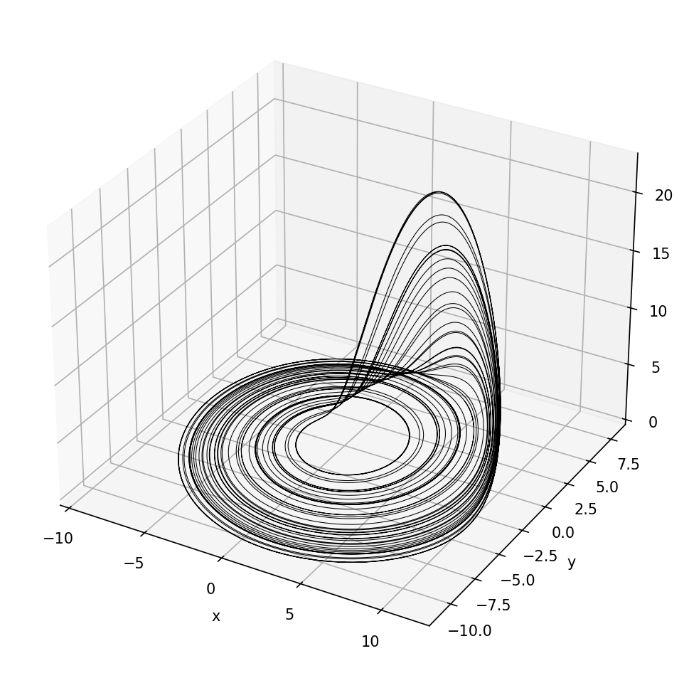

## Topics and Methods

### 1. Equilibrium Points and Local Stability

- Analytical computation of equilibrium points.
- Jacobian matrix and linearization.
- Eigenvalue and eigenvector analysis.
- Local stability and saddle-focus dynamics.
- Interpretation of the stretching and folding mechanism.
  
.png)

  
.png)

### 2. Numerical Simulation and Phase-Space Analysis

- Numerical integration using adaptive fourth-order Runge–Kutta methods (RK45).
- Three-dimensional reconstruction of the Rössler attractor.
- Two-dimensional phase-space projections.
- Geometric interpretation of rotation, stretching, folding and reinjection.

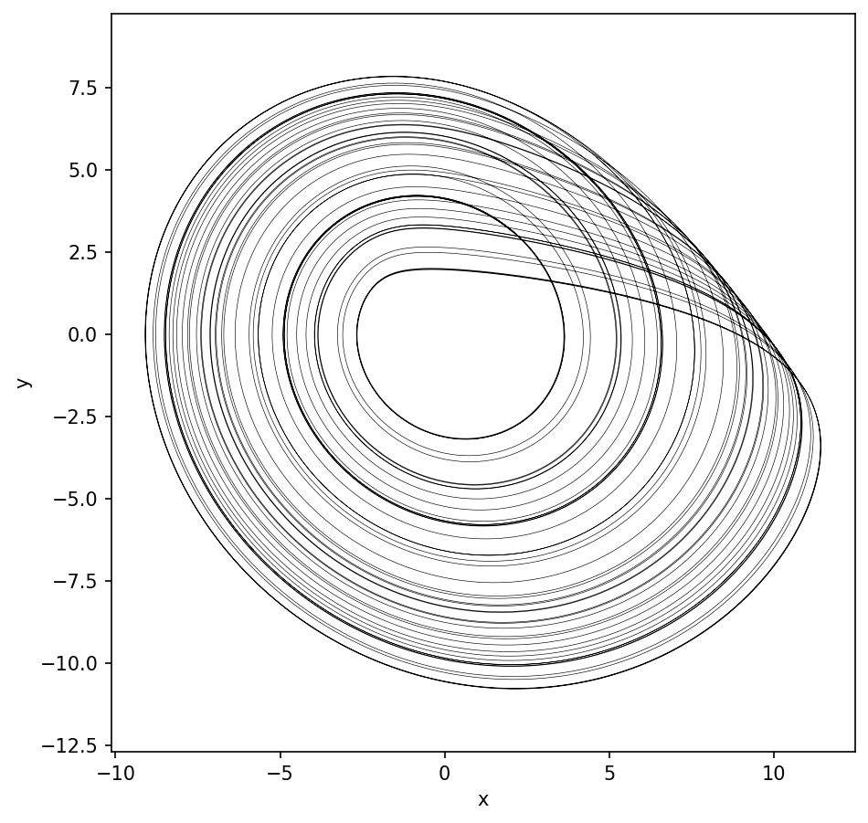
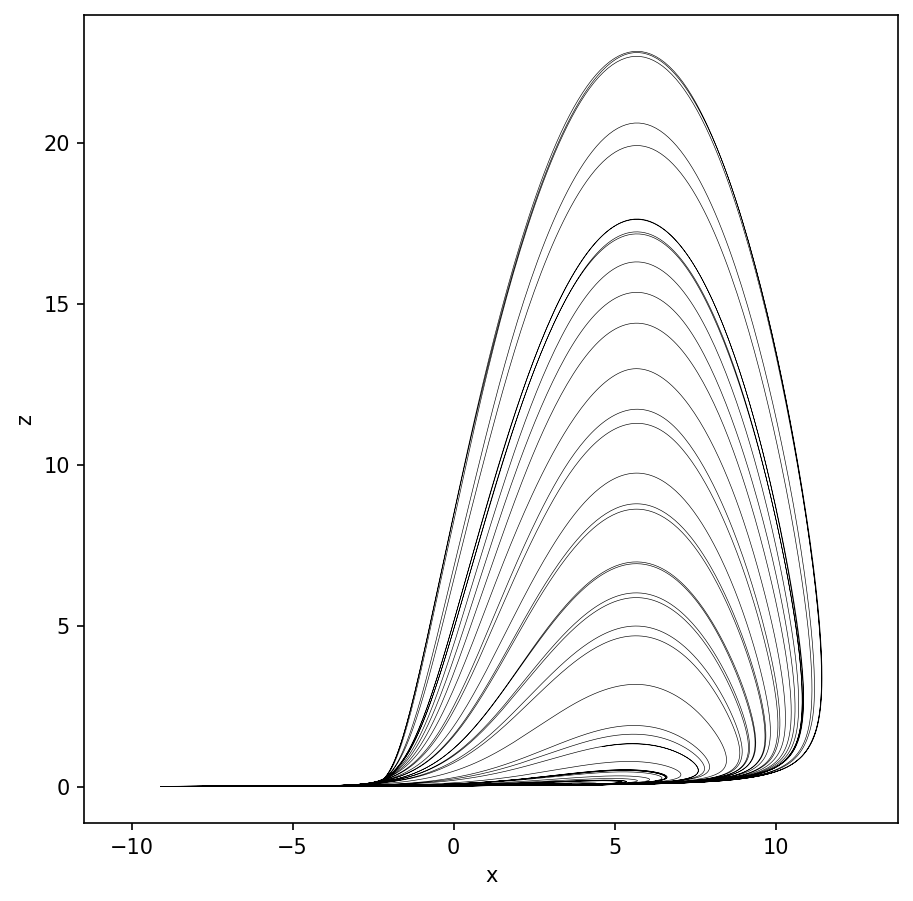
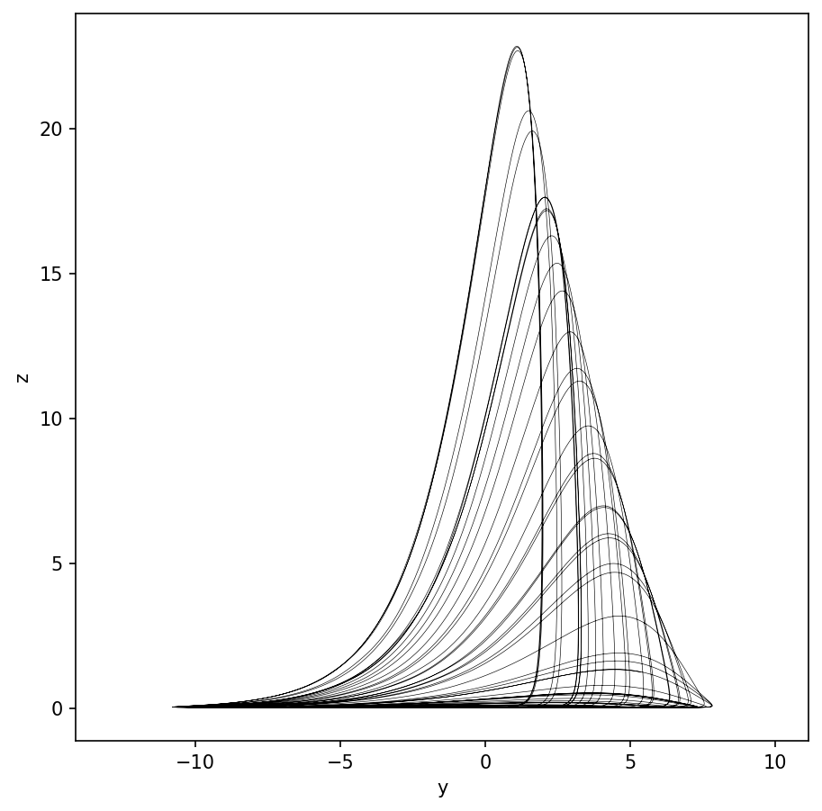

### 3. Sensitivity to Initial Conditions and Lyapunov Exponents

- Numerical comparison of trajectories with nearby initial conditions.
- Exponential divergence of initially close trajectories.
- Computation and interpretation of the Lyapunov spectrum.
- Kaplan–Yorke dimension and fractal characterization.

For the classical parameter configuration, the computed Lyapunov spectrum is approximately:

$$
\lambda_1=0.0701,\qquad
\lambda_2=0.000309,\qquad
\lambda_3=-5.3963.
$$

The corresponding Kaplan–Yorke dimension is approximately:

$$
D_{KY}\approx 2.013.
$$

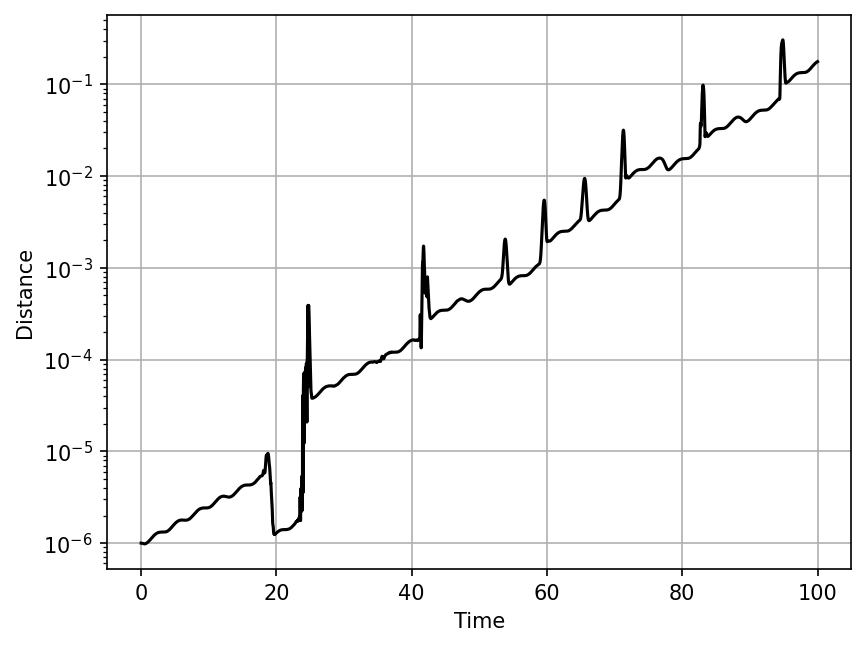

### 4. Bifurcation Analysis

Investigation of the system's dependence on its parameters by varying one parameter at a time:

- Bifurcation diagrams with respect to $\(a\)$, $\(b\)$ and $\(c\)$.
- Period-doubling cascades.
- Periodic windows and transitions to chaos.
- Evolution of attractor geometry for different parameter values.

Representative values of $\(c\)$ include:

$$
c=2.5,\quad 3.5,\quad 4.0,\quad 5.7.
$$

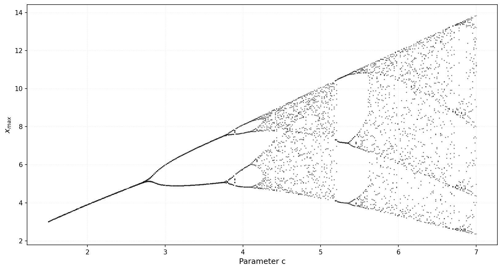

### 5. Frequency-Domain Analysis

- Discrete Fourier Transform (DFT).
- Power spectrum computation.
- Comparison between periodic and chaotic regimes.
- Identification of dominant frequencies and broadband spectral behaviour.

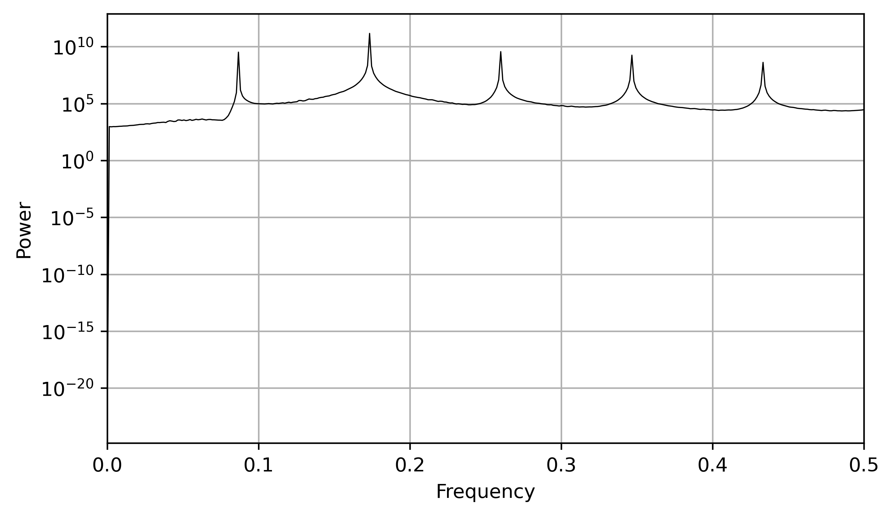
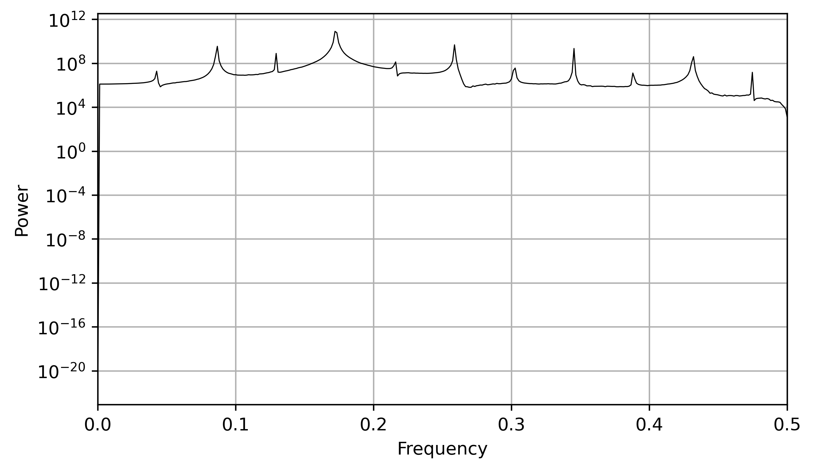
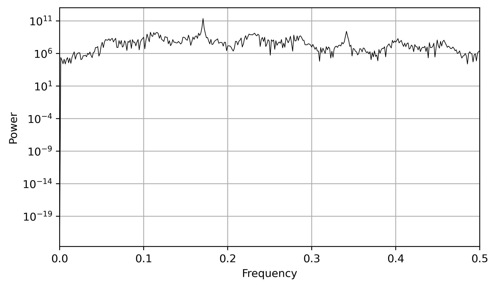

### 6. Geometric and Dynamical Structures

- Unstable periodic orbits and their role in organizing chaotic dynamics.
- Poincaré sections and discrete representations of continuous flows.
- Local maxima maps.
- Cantor-like structures in cross-sections of the attractor.
- Qualitative geometric analogy with the Möbius strip.

  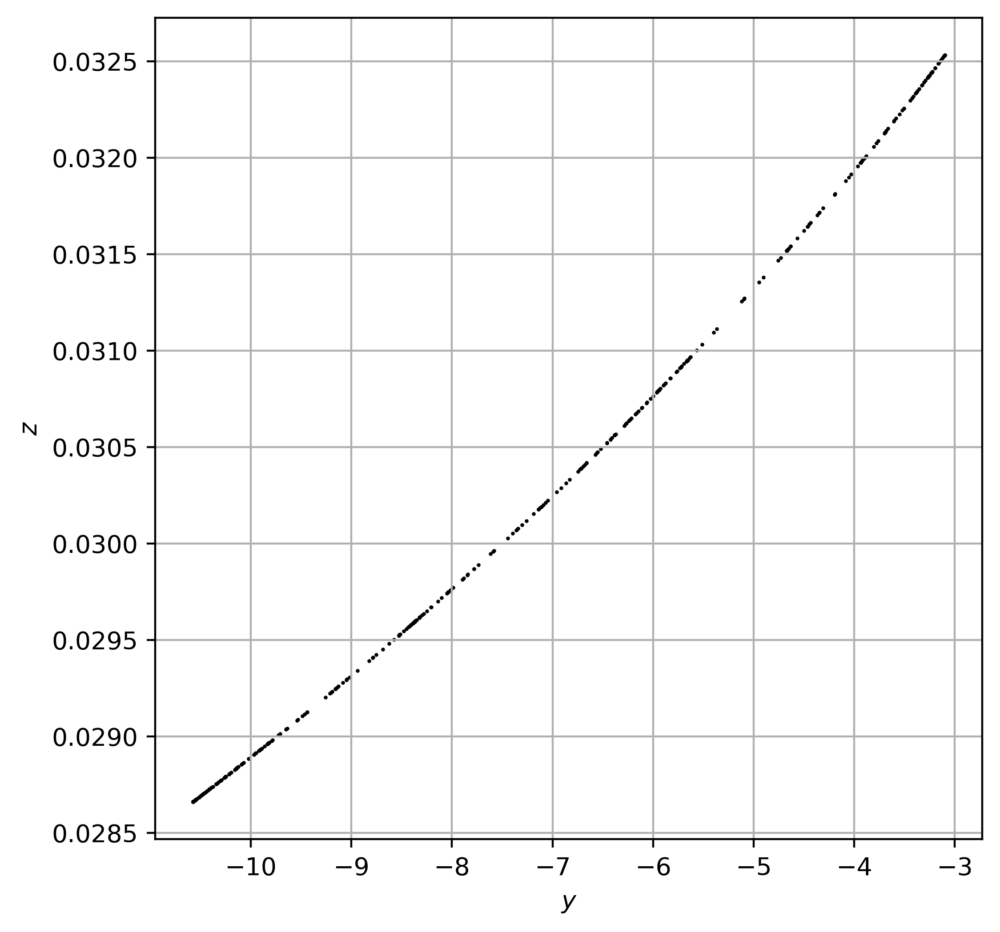
  
  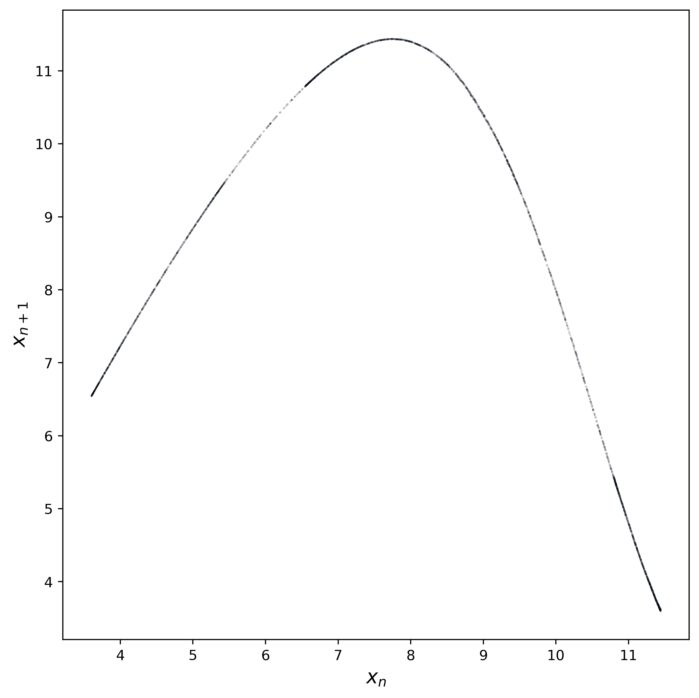
  
  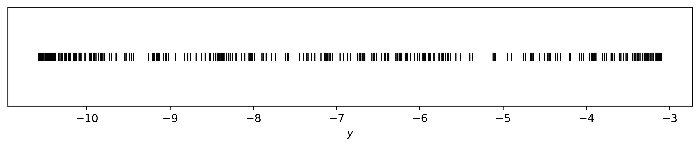

### 7. Applications and Further Explorations

- Chemical interpretation of the Rössler model, including connections with the peroxidase–oxidase reaction.
- Sonification of dynamical trajectories.
- Comparison of periodic and chaotic behaviour through audio representations.

## Numerical Results

The numerical experiments illustrate several fundamental properties of deterministic chaos:

- **Determinism:** trajectories evolve according to well-defined differential equations.
- **Sensitive dependence:** small perturbations in initial conditions lead to significant trajectory divergence.
- **Dissipativity:** phase-space volumes contract on average.
- **Strange attractors:** long-term trajectories remain confined to a complex geometric structure.
- **Period-doubling:** changes in system parameters can generate transitions from periodic oscillations to chaos.

The combination of local stability analysis, numerical integration and geometric visualization provides a comprehensive description of the system's nonlinear dynamics.

## Technologies

- Python
- NumPy
- SciPy
- Matplotlib

## Author

**Luca Casarin**

BSc in Mathematics | MSc student in Mathematical Engineering  
University of Padua
